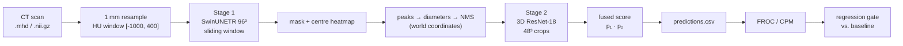

# Two-stage 3D lung nodule detection with Triton deployment and FROC regression gates

A complete, deliberately readable reference implementation of a pulmonary nodule
pipeline: **MONAI SwinUNETR detector → 3D ResNet false-positive reducer → ONNX →
NVIDIA Triton Inference Server → FROC/CPM evaluation → automated regression gate**.

[](https://github.com/your-org/lung-nodule-triton-eval/actions/workflows/ci.yml)
[](https://github.com/your-org/lung-nodule-triton-eval/actions/workflows/froc-regression.yml)
[](pyproject.toml)
[](LICENSE)



## Why two stages

A single-stage detector has to trade sensitivity against false positives at one
operating point. Splitting the problem keeps each network simple:

| | stage 1 (detector) | stage 2 (FP reducer) |
| --- | --- | --- |
| task | voxel segmentation + centre heatmap | binary classification + diameter regression |
| input | 96³ patch, 1 mm | 48³ crop around a candidate (image + mask channel) |
| output | `mask_logits`, `center_logits` | `logit`, `log diameter` |
| size | ~26 M parameters (feature size 48) | ~11 M parameters (ResNet-18 3D) |
| training data | patches sampled around annotations | annotations + mined hard negatives |

Stage 1 is optimised for recall, stage 2 removes the false positives that stage 1
produces *on this dataset* (hard-negative mining uses stage-1 predictions on the
training split, not the generic LUNA16 candidate list).

## Repository layout

```
src/lung_nodule/
├── data/          LUNA16 IO, 1 mm preprocessing, transforms, patch/crop datasets
├── models/        SwinUNETR detector, 3D ResNet FP reducer, ONNX export wrappers
├── training/      AMP training loops, losses, schedulers, checkpointing
├── inference/     sliding window, peak extraction, diameter, NMS, pipeline
├── deploy/        ONNX export, Triton runners, Triton inference CLI
└── eval/          FROC/CPM, regression gate, run history & leaderboard
configs/           stage-1, stage-2, pipeline, Triton client configs
deploy/triton/     model repository (config.pbtxt), docker-compose, Dockerfile
eval/baselines/    committed FROC baselines used by the regression gate
scripts/           thin CLIs: splits, hard-negative mining, Triton smoke test, full fold
.github/workflows/ ci, froc-regression, triton-image
```

## Quickstart

```bash
git clone https://github.com/your-org/lung-nodule-triton-eval.git
cd lung-nodule-triton-eval
python -m venv .venv && source .venv/bin/activate     # Windows: .venv\Scripts\Activate.ps1
pip install -e ".[dev]"
```

### 1. Data

Download LUNA16 and point the pipeline at your local copy. Nothing patient-related
is committed; the expected layout is documented in [`data/README.md`](data/README.md).

```bash
python scripts/make_split.py \
  --annotations data/raw/luna16/annotations/annotations.csv \
  --output configs/splits/luna16_fold0.json --val-fraction 0.2 --seed 42

make preprocess IMAGES_DIR=data/raw/luna16/subset0
```

### 2. Train both stages

```bash
make train-stage1                                   # SwinUNETR, 150 epochs
make predict IMAGES_DIR=data/raw/luna16/subset0 PRED_CSV=artifacts/predictions/train.csv  # stage 1 only
python scripts/mine_hard_negatives.py --predictions artifacts/predictions/train.csv \
    --annotations data/raw/luna16/annotations/annotations.csv \
    --split configs/splits/luna16_fold0.json --split-key train \
    --output artifacts/stage1/hard_negatives.json
make train-stage2                                   # 3D ResNet, hard negatives
```

### 3. Export and serve

```bash
make export          # ONNX + parity check → deploy/triton/model_repository/*/1/model.onnx
make triton-up       # docker compose up (GPU, ports 8000/8001/8002)
python scripts/triton_smoke_test.py --url localhost:8001
```

### 4. Predict and score

```bash
make predict-triton IMAGES_DIR=data/raw/luna16/subset0 PRED_CSV=artifacts/predictions/val.csv
make froc
make froc-regression
make leaderboard
```

Or run the whole fold end to end:

```bash
bash scripts/run_fold.sh
```

## Deployment details

Two Triton models, both on the ONNX Runtime backend:

| model | input | outputs | batching |
| --- | --- | --- | --- |
| `stage1_swinunetr` | `image` `1×96×96×96` fp32 | `mask_logits`, `center_logits` `1×96×96×96` | dynamic, max 4 |
| `stage2_fp_reducer` | `crop` `2×48×48×48` fp32 | `logit`, `diameter` `1` each | dynamic, max 32 |

Notes that matter in practice:

- **Fixed spatial dims, dynamic batch.** Swin window partitioning uses static
  reshapes, so the graph is exported for 96³ and full volumes are tiled by the
  client. This is also what makes Triton batching effective: one request can carry
  up to four windows.
- **No Triton ensemble.** Candidate extraction (local maxima, diameter estimation,
  NMS) depends on the *content* of the stage-1 output. An ensemble graph cannot
  express it without a custom backend, so the composition happens client-side in
  `NodulePipeline` — the same code path used for local PyTorch inference, which
  removes a whole class of train/serve skew.
- **Logits, not probabilities.** The graphs return raw logits; sigmoid and score
  fusion live in Python so fusion weights can change without re-exporting.
- **Parity is measured, not assumed.** `lndet-export-onnx` runs ONNX Runtime next
  to PyTorch on a random input and records max abs diff and cosine similarity in
  `model_metadata.json`.

Operational knobs: `--workers` (concurrent scans, thread-local gRPC clients),
`instance_group.count` in `config.pbtxt`, `dynamic_batching.max_queue_delay_microseconds`,
and the optional TensorRT EP block (commented out) for FP16 throughput.

## FROC regression tracking

```bash
python -m lung_nodule.eval.froc --predictions artifacts/predictions/val.csv \
    --annotations data/raw/luna16/annotations/annotations.csv \
    --output-dir artifacts/froc --bootstrap --plot

python -m lung_nodule.eval.regression --report artifacts/froc/report.json \
    --baseline eval/baselines/luna16_fold0.json --output-dir artifacts/froc --summary
```

The gate compares every metric listed in the baseline (`cpm`, `sens@Nfp`, …),
respects per-metric tolerances and directions (`lower_is_better` for
`fp_at_sens0.90`), and exits non-zero on a regression so CI fails loudly. The
committed baseline is a single JSON file, so promoting a new operating point is a
reviewable one-line diff — see [`docs/froc-regression.md`](docs/froc-regression.md).

Reference numbers currently committed in `eval/baselines/luna16_fold0.json`
(replace them with your first full run before relying on the gate):

| metric | value |
| --- | --- |
| CPM | 0.8659 |
| sensitivity @ 0.125 FP/scan | 0.712 |
| sensitivity @ 0.5 FP/scan | 0.842 |
| sensitivity @ 1 FP/scan | 0.889 |
| sensitivity @ 4 FP/scan | 0.947 |
| FP/scan at 0.90 sensitivity | 2.31 |

## Reproducibility and provenance

Every artifact written by the pipeline carries `git_sha`, a config fingerprint and
a UTC timestamp. `artifacts/froc/history.jsonl` accumulates one record per
evaluation, and `lndet-eval-tracking` renders a leaderboard plus a trend summary
(`improving` / `stable` / `degrading`) across runs.

## Limitations

- Only the two-model composition is implemented; a Triton custom backend for
  candidate extraction is future work.
- Stage-2 training uses the cached ground-truth mask as its mask channel. Feeding
  stage-1 predictions instead is a known improvement (`--stage-1-predictions`,
  not implemented).
- The committed baselines are single-fold; the gate is meant to run per fold in a
  matrix job before a full 10-fold claim is made.
- No unit tests are shipped: this repository focuses on the pipeline, the
  deployment contract and the evaluation gate.

## 中文简介

这是一个两阶段 3D 肺结节检测与假阳性抑制的参考实现：第一阶段用 MONAI
SwinUNETR 在 96³ 的 1 mm patch 上预测结节分割与中心热力图，经过峰值提取、
直径估计和世界坐标 NMS 得到候选；第二阶段用 3D ResNet-18 对 48³ 候选裁剪
（图像 + 掩膜通道）重新打分，融合后输出 LUNA16 格式预测。两个模型导出为 ONNX
并由 NVIDIA Triton Inference Server 提供服务（动态 batch + GPU 实例），客户端
复用同一套后处理逻辑以避免训练/部署偏差。评测采用 LUNA16 FROC 协议与 CPM
指标，`eval/baselines/` 中的基线配合 `eval/regression.py` 在 CI 中自动阻止
指标回退。

## Acknowledgements

LUNA16 (Grand Challenge) for the data and evaluation protocol, MONAI for
SwinUNETR and the sliding-window inference utilities, NVIDIA Triton for the
serving stack.

Licensed under the Apache License 2.0 — see [LICENSE](LICENSE).
